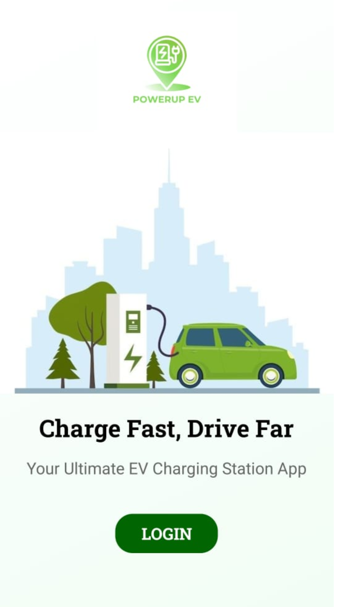
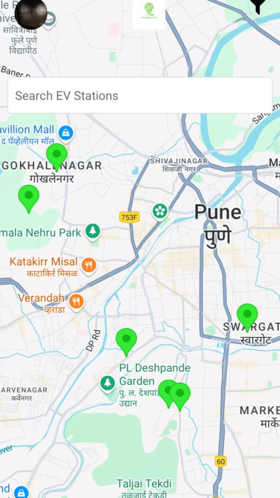
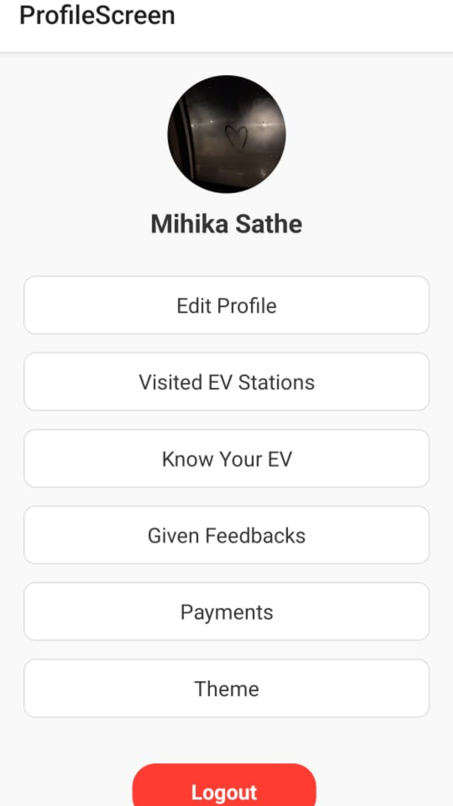
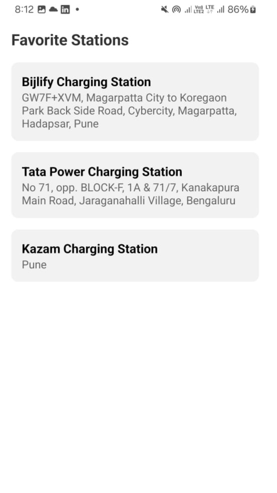

# EV Charging Station Finder 

A mobile application built using **Expo React Native** that helps users discover nearby EV charging stations based on their current location.

##  Features

-  Find nearby EV charging stations
-  Search locations using Google Places Autocomplete
-  View station details
-  Get directions through Google Maps
- Save favorite charging stations
-  Clean and responsive mobile interface

##  Tech Stack

- Expo
- React Native
- JavaScript
- Google Maps API
- Google Places API
- Axios

##  Installation

1. Clone the repository

```bash
git clone https://github.com/YOUR_USERNAME/YOUR_REPOSITORY.git
```

2. Navigate to the project folder

```bash
cd YOUR_REPOSITORY
```

3. Install dependencies

```bash
npm install
```

4. Add your Google Maps API key.

Replace every occurrence of:

```js
YOUR_GOOGLE_MAPS_API_KEY
```

with your own Google Maps API key in the project files.

5. Start the Expo development server

```bash
npx expo start
```

## 📸 Screenshots

<table>
  <tr>
    <td align="center"><b>Home Screen</b></td>
    <td align="center"><b>Search Screen</b></td>
  </tr>
  <tr>
    <td></td>
    <td></td>
  </tr>
  <tr>
    <td align="center"><b>Profile Details</b></td>
    <td align="center"><b>Favorites</b></td>
  </tr>
  <tr>
    <td></td>
    <td></td>
  </tr>
</table>


##  Project Structure

```
├── assets/
├── components/
├── screens/
├── services/
├── App.js
├── package.json
└── README.md
```

## Future Improvements

- User authentication
- Charging station reviews and ratings
- Route optimization
- Real-time charger availability
- Filter stations by charger type

##  Author

**PRIYA NAGARE**

Computer Engineering Student- B.E.
PVGCOETM,PUNE
